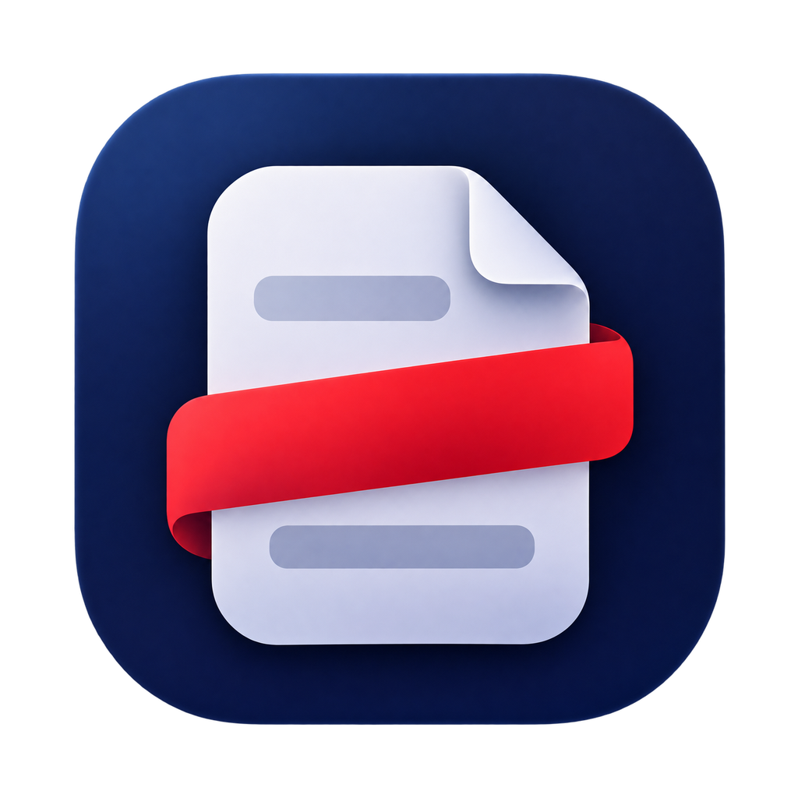
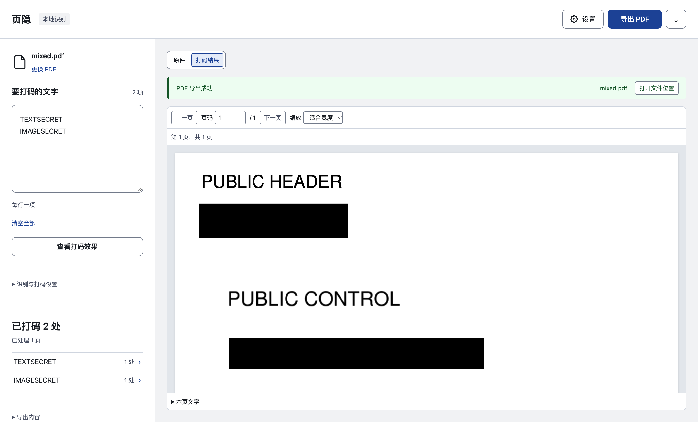

# 页隐 · Redactera

**PDF Redaction & Document Sanitization**

页隐可以按关键词移除 PDF 中的敏感内容，支持文本、扫描件和混合页面。处理后保存一份新文件。

[下载安装包与 SHA256 校验文件](https://github.com/WaterGauge/redactera/releases)

页隐 2.0.0 是本仓库的首个公开发行版。旧版应用使用 PDF Desensitization 名称。

## 使用

1. 选择或拖入 PDF。
2. 在「要打码的文字」里输入关键词，每行一项。
3. 点击「导出 PDF」，选择保存位置。

可以先点「查看打码效果」，按关键词定位处理位置。需要图片时，在导出菜单选择「导出为图片」，应用会将 PNG 文件打包成 ZIP。

*开发候选界面，使用合成 PDF。*

## 处理范围

- 支持跨行文字和扫描页面的识别。导出 PDF 时会清理附件、书签和元数据等内容，并将表单、批注等交互内容转为静态页面。
- 默认在本机识别，文档留在设备上。选择 PaddleOCR 时会向配置的服务上传原始 PDF，选择百度 OCR 时会上传打码前的页面图像。
- 识别结果受页面结构和图像质量影响。共享前请核对关键文字和扫描页。没有找到关键词时，另存的副本仍会保留原文。

## 安装

从 Releases 选择适合系统和处理器的安装包，并与同一版本的 SHA256 校验文件核对。macOS 和 Windows 的可用附件及要求以对应版本为准。

旧版用户可以直接下载 2.0.0 的 DMG 或 Setup.exe，按正常安装流程手动升级。macOS 发行采用临时签名（ad hoc），首次打开及旧名应用迁移见 [macOS 安装说明](docs/handbook/mac-signing-notarization.md)。

## 文档

- [开发与构建](docs/public/development.md)、[测试](docs/public/testing.md)、[架构与数据处理](docs/public/architecture.md)
- [版本记录](CHANGELOG.md)、[发布流程](docs/releases.md)、[贡献方式](CONTRIBUTING.md)
- [安全问题报告](SECURITY.md)、[AGPLv3 项目许可证](LICENSE)、[第三方组件许可](docs/public/licensing.md)

## English

Redactera is a desktop app for removing sensitive PDF content by keyword. Open a PDF, enter one term per line, and export a copy. You can preview matches before exporting to PDF or PNG ZIP.

OCR runs locally by default. PaddleOCR sends the original PDF to the configured service. Baidu OCR sends page images before redaction. Check the exported copy before sharing, especially for scanned documents.

The screenshot shows the development build. To upgrade from PDF Desensitization, get the Redactera 2.0.0 installer and SHA256 checksums from [Releases](https://github.com/WaterGauge/redactera/releases). For macOS installation and migration from the earlier app name, see the [macOS first-launch guide](docs/handbook/mac-signing-notarization.md).
